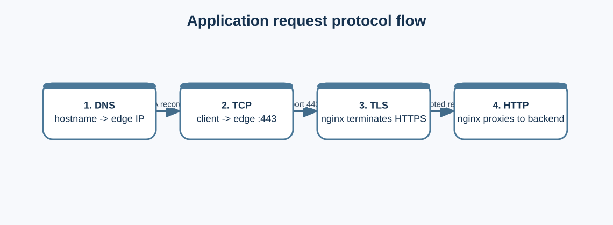
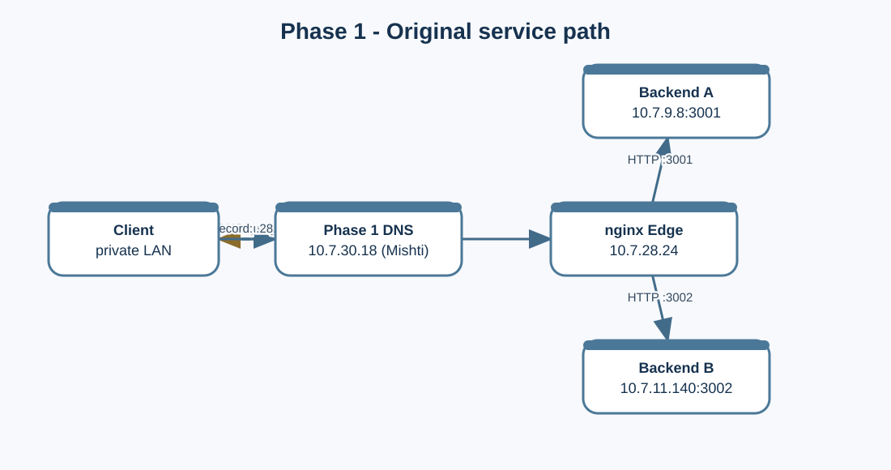
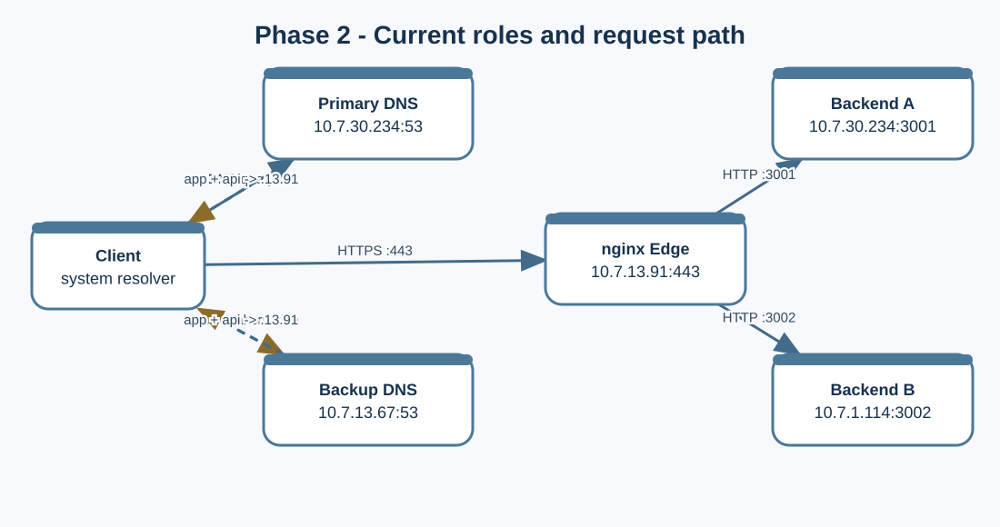

# Computer Networks Course Project

## Private Network Service Platform

### Phase 2: Harden, Recover, and Extend

**Phase 2 Evidence Document and Final Report**  
**Team:** teamX  
**Team members:** Nishtha Gupta, Mishti, Aditya, and Shrijan  
**Repository:** [github.com/nishtha-09-gupta/TeamSubnetCN](https://github.com/nishtha-09-gupta/TeamSubnetCN)  
**Report date:** 22 November 2026  
**Scope:** Phase 1 context and Phase 2 Extensions A-E

> The application remains intentionally simple; the network path and its behavior are the focus of this project. This report records implementation details and observations supported by the repository and supplied terminal transcripts. A screenshot placeholder is not evidence that a demonstration passed.

## Evidence status key

- **Implemented in repository** means the configuration or helper script exists in the current project.
- **Observed in supplied terminal transcript** means a terminal output was supplied for that behavior. It does not mean the current repository helper was used.
- **Pending Live Verification** means the required demonstration is not established by the supplied evidence and must be run on the team Macs.
- Screenshots have not been inserted. The reserved figure panels below specify what to capture and what each capture should demonstrate.

## 1. Introduction

The Private Network Service Platform is a local Computer Networks course project deployed across four macOS laptops. A client uses a private `.test` hostname, receives an address from team-managed DNS, opens a TCP and TLS connection to an nginx edge, and receives an HTTP response from one of two Express backends. Wireshark and terminal tools make the protocol path observable.

Phase 1 built the original DNS, edge, and two-backend service. Phase 2 keeps that service architecture and adds a second resolver, short DNS TTLs and controlled record changes, backend firewall rules, passive nginx upstream failover, and a controlled DNS-based standby-edge migration. No cloud service or additional physical server is part of the implementation.

This report covers Extensions A-E only. The project specification also describes a faculty-controlled troubleshooting challenge; the faculty introduces that challenge during evaluation. This report does not claim team implementation or evidence for that faculty activity.

### Evaluation objective

The final demonstration should establish how a request crosses these layers and how the system responds to selected failures:

```text
Private DNS lookup -> TCP connection -> TLS session -> HTTP request -> nginx upstream -> Express backend
```

The specification requires the team to explain what is configured, show live observations, and distinguish a configuration check from an end-to-end network demonstration. The statuses in this report follow that standard.



## 2. Phase 1 recap and original architecture

### 2.1 Original machine roles

The Phase 1 project used the same four-machine service model as Phase 2. Its original service allocation was:

| Team member | Phase 1 role | Historical address | Service |
|---|---|---:|---|
| Mishti | Primary DNS resolver and test client | `10.7.30.18` | dnsmasq, UDP/TCP 53 |
| Aditya | nginx edge, reverse proxy, load balancer, TLS termination | `10.7.28.24` | HTTP 80 and HTTPS 443 |
| Nishtha Gupta | Backend A | `10.7.9.8` | Express HTTP 3001 |
| Shrijan | Backend B and test client | `10.7.11.140` | Express HTTP 3002 |

**Confirmed Phase 1 DNS role:** Mishti’s Mac at `10.7.30.18` hosted the Phase 1 dnsmasq resolver. The resolver’s application records pointed to the Phase 1 edge at `10.7.28.24`. These historical addresses remain separate from the Phase 2 allocation.

### 2.2 Phase 1 request flow

In Phase 1, `app.teamX.test` and `api.teamX.test` were configured to resolve to the original nginx edge at `10.7.28.24`. The DNS lookup itself only returned an address; the client then established the HTTPS connection to nginx.



The expected protocol sequence was:

1. The client requested the private hostname from its configured resolver.
2. DNS returned the edge address. DNS did not open a TCP connection.
3. The client established TCP to the edge on port 443.
4. The client and nginx negotiated TLS; nginx terminated HTTPS.
5. nginx forwarded the HTTP request to Backend A or Backend B over the LAN.
6. The backend response returned through nginx to the client.

### 2.3 Phase 1 capabilities retained

The Phase 1 implementation established the service behaviors that Phase 2 is intended to retain:

- Private LAN connectivity among four macOS laptops.
- dnsmasq records for `app.teamX.test` and `api.teamX.test`.
- Two Node.js/Express backends on ports 3001 and 3002.
- nginx reverse proxying and round-robin load balancing.
- HTTPS/TLS termination at nginx with a self-signed certificate.
- Backend identification using `X-Backend` and edge identification using `X-Edge`.
- `Cache-Control: max-age=60`, Express ETag generation, and conditional-request behavior.
- Wireshark evidence for DNS, TCP, TLS, and encrypted application traffic.

The Phase 1 evidence remains in the repository, including `Phase1Evidence_Document.pdf`, `screenshots/`, `terminals/`, `wireshark/`, and `architecture/`. This Phase 2 report does not alter those records.

## 3. Phase 2 architecture and address allocation

### 3.1 Current machine roles

The following allocation is the current Phase 2 network. Nishtha's Mac hosts two independent services: primary DNS on port 53 and Backend A on port 3001.

| Team member | Phase 2 role | Phase 2 IPv4 | Service and port |
|---|---|---:|---|
| Nishtha | Primary DNS and Backend A | `10.7.30.234` | dnsmasq 53; Express 3001 |
| Mishti | Backup DNS | `10.7.13.67` | dnsmasq 53 |
| Aditya | nginx edge / reverse proxy | `10.7.13.91` | nginx HTTP 80, HTTPS 443 |
| Shrijan | Backend B | `10.7.1.114` | Express 3002 |
| Standby edge | Pending confirmation | **Pending confirmation; no address assigned in this report** | nginx 80/443 when prepared |

The standby address is intentionally unresolved. It must be read from the actual standby Mac interface and supplied to the validation and migration procedures. No address is assumed.

### 3.2 Phase 1 and Phase 2 address comparison

| Role | Phase 1 allocation | Phase 2 allocation | Current use |
|---|---:|---:|---|
| Backend A | `10.7.9.8` | `10.7.30.234` | Phase 2 value only |
| nginx edge | `10.7.28.24` | `10.7.13.91` | Phase 2 value only |
| Backend B | `10.7.11.140` | `10.7.1.114` | Phase 2 value only |
| Primary DNS | `10.7.30.18` | `10.7.30.234` | Phase 2 value only |
| Backup DNS | Not part of Phase 1 | `10.7.13.67` | Phase 2 only |

The Phase 1 values are historical and must not be copied into current Phase 2 commands, DNS records, nginx upstreams, or firewall rules.

### 3.3 Phase 2 topology and names

Both project names are intended to resolve to the current edge:

```text
app.teamX.test -> 10.7.13.91
api.teamX.test -> 10.7.13.91
```



A successful direct query to the backup proves that the backup resolver can answer. It does not by itself prove client-side failover when the primary is stopped. macOS resolver selection and cache behavior must be observed separately.

## 4. Current implementation map

| Component | Repository file(s) | Purpose in Phase 2 |
|---|---|---|
| Shared script values | `Helper_Scripts/Phase2/config.sh` | Phase 2 host IPs, names, ports, TTL, TLS paths, and interface defaults |
| Primary DNS | `Configuration_Bundle/dnsmasq/dnsmasq.conf` | Primary dnsmasq listener and project records |
| Backup DNS | `Configuration_Bundle/dnsmasq/phase2-backup-dnsmasq.conf` | Separate dnsmasq listener for Mishti's Phase 2 address and same records |
| Client DNS | `Configuration_Bundle/client/CLIENT_DNS_SETUP.md` | macOS resolver configuration and direct query commands |
| Active nginx | `Configuration_Bundle/nginx/teamx.conf` | HTTP redirect, TLS termination, backend pool, proxy headers and retries |
| HA nginx reference | `Configuration_Bundle/nginx/phase2-ha.conf` | Phase 2 upstream and passive failure settings |
| Standby nginx | `Configuration_Bundle/nginx/standby-edge.conf` | Separate server configuration for a confirmed standby host |
| Backend A/B | `backends/backend-a/backend-A.js`; `backends/backend-b/backend-B.js` | Express routes `/` and `/api/status` |
| DNS checks and change/restore | `Helper_Scripts/Phase2/dns/` | Direct primary/backup queries, failover observation, TTL, controlled file changes, restore, cache flush |
| Firewall | `Helper_Scripts/Phase2/firewall/` | macOS PF anchor apply, verification and rollback |
| HA checks | `Helper_Scripts/Phase2/ha/` | Direct backend health and repeated edge requests |
| Edge migration | `Helper_Scripts/Phase2/edge-migration/` | Standby validation, cutover verification and DNS rollback verification |
| TLS instructions | `Configuration_Bundle/tls/TLS_SETUP_NOTES.md` | Self-signed certificate creation and macOS client trust |

The repository does not contain a private key. The current nginx configuration refers to locally installed certificate paths under `/opt/homebrew/etc/nginx/certs/`; each edge host must have the appropriate certificate and key installed securely.

### 4.1 Backend endpoint and response identification

The Express implementations expose `/` and `/api/status`. The root route returns `{"message":"Backend A is running"}` or `{"message":"Backend B is running"}` and does not set `X-Backend`. The `/api/status` route returns `{"backend":"A","status":"ok"}` on Backend A or `{"backend":"B","status":"ok"}` on Backend B. It sets `X-Backend: A` or `X-Backend: B` and `Cache-Control: max-age=60`; Express also supplies its ETag response behavior. The nginx HTTPS location adds `X-Edge` with the edge machine's hostname. These are the source-defined response values; live Phase 2 HTTPS headers still require the captures listed under Extension D.

| Request path | Backend response body | Relevant response headers |
|---|---|---|
| `/` | `{"message":"Backend A is running"}` or `{"message":"Backend B is running"}` | nginx adds `X-Edge`; the root route does not set `X-Backend` |
| `/api/status` | `{"backend":"A","status":"ok"}` or `{"backend":"B","status":"ok"}` | `X-Backend: A` or `B`; `Cache-Control: max-age=60`; Express ETag; nginx `X-Edge` |

## 5. Extension A - Backup DNS Resolver

### 5.1 Objective and design

A backup resolver keeps private name service available when the primary dnsmasq process is unavailable. The Phase 2 resolver roles are:

- Primary: Nishtha, `10.7.30.234`.
- Backup: Mishti, `10.7.13.67`.

Both resolver configurations contain A records for `app.teamX.test` and `api.teamX.test`, targeting the Phase 2 nginx edge at `10.7.13.91`. The backup config is separate so it can be launched and changed on a different Mac. Client setup lists both server addresses. Since macOS can cache answers and apply resolver selection rules, the report distinguishes direct server tests from system resolver behavior.

### 5.2 Configuration and repeatable checks

On the primary DNS Mac, validate the installed primary config with the Homebrew dnsmasq executable. On the backup DNS Mac, validate the backup config and launch it using its distinct `--conf-file` argument. The repository copies are:

```text
Configuration_Bundle/dnsmasq/dnsmasq.conf
Configuration_Bundle/dnsmasq/phase2-backup-dnsmasq.conf
```

The backup launch command documented for the deployment is:

```bash
sudo "$(brew --prefix)/sbin/dnsmasq" --no-daemon \
  --conf-file="$(brew --prefix)/etc/dnsmasq-backup.conf"
```

Check each DNS server independently for both records and their TTLs:

```bash
Helper_Scripts/Phase2/dns/test_primary_dns.sh
Helper_Scripts/Phase2/dns/test_backup_dns.sh

dig @10.7.30.234 app.teamX.test +noall +answer +ttlid
dig @10.7.30.234 api.teamX.test +noall +answer +ttlid
dig @10.7.13.67 app.teamX.test +noall +answer +ttlid
dig @10.7.13.67 api.teamX.test +noall +answer +ttlid
```

The controlled outage workflow is deliberately manual. Record the baseline, stop primary dnsmasq on Nishtha's Mac, run the after-stop checks, then restore the primary service:

```bash
Helper_Scripts/Phase2/dns/test_dns_failover.sh before
# Stop primary dnsmasq manually on Nishtha's Mac.
Helper_Scripts/Phase2/dns/test_dns_failover.sh after-primary-stop
# Start primary dnsmasq again manually after the observation.
```

The helper does not stop either service. Its direct `dig @server` results indicate server reachability; its `scutil --dns` and `dscacheutil` sections report the macOS resolver view separately.

### 5.3 Observations and verification status

**Implemented in repository:** a separate backup dnsmasq config, both project records, Phase 2 IPs, dual resolver client instructions, direct primary and backup checks, and a before/after-primary-stop procedure.

**Observed in supplied terminal transcripts:** direct queries to `10.7.30.234` and `10.7.13.67` returned `NOERROR` and the expected edge address `10.7.13.91` for recorded app/API queries. The backup Mac transcript shows dnsmasq already listening on `10.7.13.67:53`; attempts to launch a second instance on the same address failed with “Address already in use.” That is evidence of an already-bound service, not evidence that primary failure was tested. Some intermediate transcripts also show a backup-named config listening on `10.7.30.234` on Nishtha's host; those attempts are not evidence of the backup resolver on Mishti's Mac and must not be treated as the final role assignment.

**Pending Live Verification:** the supplied transcripts do not show the primary service stopped followed by a client lookup that succeeds through the backup. Direct backup answers alone do not establish that failover demonstration.

**Learning:** DNS redundancy has two independent parts: maintaining a functioning second DNS service and showing that a client can resolve names through it when the primary is unavailable. Server address lists do not prove resolver selection or cache behavior.

#### Figure A-1. Primary and backup resolver configuration

**Capture:** on the two DNS Macs, show the installed config paths, `listen-address`, `local-ttl`, both `address=` records, and successful `dnsmasq --test --conf-file=...` results. Include host identity or `ifconfig en0` so the two configs are not confused.  
**Demonstrates:** each Mac runs the correct resolver config and both hostnames map to the Phase 2 edge.  
**Status:** configuration exists in the repository; insert screenshots from the actual two hosts.

> **[SCREENSHOT PLACEHOLDER - Extension A: Primary and backup DNS configuration]**  
> Reserved for a legible terminal capture. No image has been supplied for this report.
>
>
>
>
>

#### Figure A-2. Direct answers from both DNS servers

**Capture:** run the four `dig @10.7.30.234` and `dig @10.7.13.67` commands above with `+noall +answer +ttlid`.  
**Demonstrates:** both resolvers independently answer for `app.teamX.test` and `api.teamX.test`.  
**Status:** direct DNS answers appear in supplied transcripts; the screenshot remains to be inserted.

> **[SCREENSHOT PLACEHOLDER - Extension A: Direct primary and backup DNS answers]**  
> Reserved for a legible terminal capture. No image has been supplied for this report.
>
>
>
>
>

#### Figure A-3. Client resolution after primary DNS stops

**Capture:** show the `before` results, manually stop primary dnsmasq, show `test_dns_failover.sh after-primary-stop`, include direct backup results and the system resolver output. Restart primary only after capturing the outage state.  
**Demonstrates:** backup server response and client resolution during primary failure are distinct observations.  
**Status:** **Pending Live Verification.** The supplied transcripts do not show this outage test.

> **[SCREENSHOT PLACEHOLDER - Extension A: Backup DNS response during primary outage]**  
> **Pending Live Verification.** This is a planned capture location, not a completed result.
>
>
>
>
>

## 6. Extension B - DNS TTL and Controlled Record Change

### 6.1 Objective and configuration

A short TTL makes a controlled DNS change observable within a demonstration window. Both Phase 2 dnsmasq files set `local-ttl=30`. This is the local answer TTL in dnsmasq; the report does not imply that editing a resolver config immediately updates all client caches.

The DNS records in the committed baseline are:

```text
app.teamX.test -> 10.7.13.91
api.teamX.test -> 10.7.13.91
```

The `change_dns_record.sh` helper updates both records in a selected resolver config, records a validated original copy on the first change, validates a candidate before installation, requests explicit confirmation, and atomically replaces the file. It is run with administrator privileges on each DNS Mac and does not restart dnsmasq. The separate `restore_dns_record.sh` validates and restores the saved config. `test_dns_ttl.sh [EXPECTED_IPV4]` checks direct A answers and TTL values against both resolver addresses; the default expected IP is the normal Phase 2 edge.

Command syntax (substitute the selected resolver config path and a valid demonstration address):

```bash
sudo Helper_Scripts/Phase2/dns/change_dns_record.sh DNSMASQ_CONFIG NEW_APP_IP [NEW_API_IP]
Helper_Scripts/Phase2/dns/test_dns_ttl.sh NEW_EXPECTED_IP
sudo Helper_Scripts/Phase2/dns/restore_dns_record.sh DNSMASQ_CONFIG
```

After each file change, restart the resolver service/process manually. The original record is restored independently on both DNS Macs. A client may retain the earlier answer until its cache expires; `flush_macos_dns_cache.sh` provides a confirmation-gated macOS cache flush for a deliberate uncached check.

### 6.2 Correct interpretation of a record-change demonstration

A complete TTL demonstration records four different observations:

1. **Resolver record:** direct `dig @DNS_IP name A` output shows what that DNS server currently answers.
2. **Client cached response:** a client query before expiry may still show the old address.
3. **Expiry:** after the remaining TTL elapses, the client query can obtain the new address.
4. **Manual flush:** a deliberate local cache flush can request an immediate fresh lookup; it is a separate action from waiting for TTL expiry.

A direct `dig @server` query bypasses the client's normal resolver cache path and therefore does not by itself show that a client has retained or expired an older answer.

### 6.3 Observations and verification status

**Implemented in repository:** `local-ttl=30` is in both Phase 2 resolver configs; the helper can update and restore both app and API records; the TTL helper prints direct records and the system resolver view.

**Observed in supplied terminal transcripts:** a dnsmasq config test printed `syntax check OK`; a query with the TTL column displayed `30`; and a manual config edit temporarily changed `app.teamX.test` to `10.7.30.234` while the API record remained `10.7.13.91`. A direct query to the primary address later returned `10.7.30.234` with TTL 30. This is evidence of a server-side record change in an intermediate test, not proof that both resolver configs were updated together or that a client held the old answer until expiry.

The supplied transcripts also show an attempted cache flush followed by `dig app.teamX.test` using the public resolver `8.8.8.8`, which returned `NXDOMAIN`. That does not demonstrate private client resolution after the flush. Some intermediate DNS configs had TTL 0 before `local-ttl=30` was added. The record state and TTL varied during the captured setup; use the current checked-in files as the intended baseline.

**Pending Live Verification:** a controlled run using the repository change/restore helpers on both DNS hosts; client-side old-answer retention; TTL expiration to the new answer; cache flush followed by a successful private answer; and final restoration of both resolver records.

**Learning:** authoritative/local resolver state, recursive or operating-system cache state, TTL expiration, and manual cache flush are distinct. A DNS change is not an instantaneous global cutover.

#### Figure B-1. Baseline DNS record and TTL

**Capture:** `dig +noall +answer +ttlid @10.7.30.234 app.teamX.test A` and the equivalent commands for both names and both resolvers.  
**Demonstrates:** the baseline answer and TTL supplied directly by each resolver before a controlled edit.  
**Status:** TTL 30 is present in supplied transcript output; capture a clean baseline from the current configs.

> **[SCREENSHOT PLACEHOLDER - Extension B: Baseline records and TTL]**  
> Reserved for current resolver output; no screenshot supplied.
>
>
>
>

#### Figure B-2. Controlled record change and direct server answer

**Capture:** use `change_dns_record.sh` on one resolver, show the confirmation and dnsmasq restart, then query its app/API records directly. Show the other resolver separately until it is changed.  
**Demonstrates:** a deliberate local record change and that the resolvers may temporarily disagree during a staged update.  
**Status:** a manual intermediate edit is present in text transcripts; the current scripted workflow is **Pending Live Verification**.

> **[SCREENSHOT PLACEHOLDER - Extension B: Record before and after controlled change]**  
> Reserved for the current helper-driven test; no screenshot supplied.
>
>
>
>

#### Figure B-3. Client cache expiry and explicit cache flush

**Capture:** on one client, record the system resolver answer before the change, change the DNS record, repeat before TTL expiry, wait at least the observed TTL, repeat after expiry, flush with the helper, and query again. Show the configured resolver list with `scutil --dns`.  
**Demonstrates:** the cached old answer, its expiry, and the separate immediate-flush path.  
**Status:** **Pending Live Verification.** The supplied post-flush lookup used a public resolver and returned `NXDOMAIN`, so it does not establish this result.

> **[SCREENSHOT PLACEHOLDER - Extension B: Cached answer, TTL expiry, and cache flush]**  
> **Pending Live Verification.** This is a planned capture location.
>
>
>
>

## 7. Extension C - Service Isolation and Backend PF Rules

### 7.1 Objective and rule design

Backend ports should accept service traffic from the authorized nginx edge, not from ordinary client machines. The Phase 2 objective is:

```text
Edge 10.7.13.91 -> Backend A 10.7.30.234:3001 = ALLOWED
Edge 10.7.13.91 -> Backend B 10.7.1.114:3002 = ALLOWED
Other client -> Backend A:3001 = BLOCKED
Other client -> Backend B:3002 = BLOCKED
```

The repository uses macOS PF and a dedicated `teamphase2` anchor. `apply_backend_firewall.sh` is parameterized for role `A` or `B`, reads shared IP and port defaults from `config.sh`, preserves existing anchor content outside its own marked role section, generates the edge allow rule, loopback rule, and inbound block rule, and supports `--dry-run`. The script confirms the existing `teamphase2` anchor hook in `/etc/pf.conf`; it backs up and loads the anchor file only. It does not rewrite, back up, or reload the base `/etc/pf.conf`. Application requires explicit operator confirmation. If PF was disabled, the installer records its PF enable reference token so rollback can release that reference without disabling unrelated PF users.

Use the matching role on each backend host. Review dry-run output first:

```bash
Helper_Scripts/Phase2/firewall/apply_backend_firewall.sh --dry-run A
Helper_Scripts/Phase2/firewall/apply_backend_firewall.sh --dry-run B
```

Applying is an administrator operation and asks for `YES`. The installer prints the saved anchor path and rollback command. When rules for both backends are applied, restore anchor snapshots in reverse application order.

Verify from the edge before checking from a separate client Mac:

```bash
Helper_Scripts/Phase2/firewall/verify_backend_isolation.sh edge
Helper_Scripts/Phase2/firewall/verify_backend_isolation.sh client
```

The edge test also calls the backend health helper, preventing a stopped service from being mistaken for a successful firewall block. The client test checks TCP reachability to ports 3001 and 3002.

### 7.2 Observations and verification status

**Implemented in repository:** role-specific parameterized PF generation, shared Phase 2 addresses, separate dry-run, confirmation, anchor backup and rollback, and no base-ruleset reload from the installer.

**Observed in supplied terminal transcripts:** PF rule syntax was checked; the `teamphase2` anchor was listed and loaded in terminal sessions; PF was enabled with `pfctl -E` in recorded manual tests; counters for an edge allow rule were nonzero in one capture. A client-side `nc` attempt to `10.7.1.114:3002` timed out in another transcript. The evidence is not a clean paired test showing current repository script application followed by edge success and independent client block for both A and B.

The supplied historical commands manually edited `/etc/pf.conf` and used `pfctl -f /etc/pf.conf` during experimentation. Those records are not the current recommended helper workflow and should not be replayed for this report. The current helper deliberately loads only the `teamphase2` anchor. The separate client test transcript and PF status outputs also came from different hosts/times; a timeout alone cannot prove a firewall block if the service or route is unavailable.

**Pending Live Verification:** run current repository `--dry-run` and apply workflow on each backend Mac; verify both ports are reachable from Aditya's edge; then run from a distinct client and capture both blocked results; record anchor rollback and verify restored state. Keep SSH and unrelated services outside the backend-port rules.

**Learning:** allow and block evidence must be paired with a known-running backend and tested from known source roles. A connection timeout alone is ambiguous. Anchor-scoped updates and rollback reduce the risk of disrupting unrelated macOS firewall state.

#### Figure C-1. PF anchor rules on both backend Macs

**Capture:** `sudo pfctl -a teamphase2 -sr` and `sudo pfctl -s info` on the backend host after applying the corresponding current helper. Include the role, host IP, and saved anchor backup path.  
**Demonstrates:** only the intended Phase 2 backend-port policy is loaded in the named anchor and PF state is known.  
**Status:** PF anchor/rule output exists in transcripts from manual sessions; current helper workflow capture remains pending.

> **[SCREENSHOT PLACEHOLDER - Extension C: Current teamphase2 rules applied]**  
> Reserved for A and B host screenshots; no images supplied.
>
>
>
>

#### Figure C-2. Edge-to-backend TCP access

**Capture:** from Aditya's Mac, run `nc -vz -G 3 10.7.30.234 3001` and `nc -vz -G 3 10.7.1.114 3002` after PF is active and both backends are healthy.  
**Demonstrates:** nginx edge source can still reach both service ports through the restriction.  
**Status:** supplied edge transcript shows both connections succeeded before or outside a verified current PF pairing; post-apply paired proof is **Pending Live Verification**.

> **[SCREENSHOT PLACEHOLDER - Extension C: Edge reaches Backend A and Backend B]**  
> **Pending Live Verification** for the paired post-apply test.
>
>
>
>

#### Figure C-3. Client-to-backend block and rollback

**Capture:** from a distinct client Mac, run the same two `nc -vz -G 3` commands; then use the printed rollback command and show the restored anchor.  
**Demonstrates:** the client cannot directly connect while the edge can, and the firewall change can be reversed.  
**Status:** **Pending Live Verification.** Supplied timeout evidence is not paired with a proven live service and edge success at the same time.

> **[SCREENSHOT PLACEHOLDER - Extension C: Client blocked and anchor rollback]**  
> **Pending Live Verification.**
>
>
>
>

## 8. Extension D - High-Availability Backend Failover

### 8.1 Existing service and nginx behavior

The nginx upstream in `Configuration_Bundle/nginx/teamx.conf` contains:

```text
10.7.30.234:3001  Backend A
10.7.1.114:3002   Backend B
```

The upstream uses `max_fails=1` and `fail_timeout=10s`; the server location sets proxy connect/send/read timeouts and `proxy_next_upstream` retry behavior. This is passive failure detection from requests, not continuous active health checking. If one backend stops responding, nginx can mark it unavailable for the configured interval and try another upstream for eligible requests. If both are unavailable, the edge can return an upstream error such as 502.

`check_backend_health.sh` queries each backend's `/api/status`, checks HTTP success and expected backend identity. `test_backend_failover.sh` checks backend status first, then sends repeated HTTPS requests and prints HTTP status, `X-Backend`, and `X-Edge`. It takes an optional URL; request count is controlled by `COUNT`. It never terminates or restarts a remote process.

### 8.2 Repeatable failover and recovery procedure

Run from a client that trusts the project edge certificate:

```bash
Helper_Scripts/Phase2/ha/check_backend_health.sh
COUNT=10 Helper_Scripts/Phase2/ha/test_backend_failover.sh
```

Then perform the failure and recovery manually:

1. Confirm both direct backend health checks pass and the edge requests show both backend identifiers over the baseline run.
2. Stop Backend A on Nishtha's Mac using the team's normal local process/service procedure. Do not use a remote-kill command.
3. Run the HA test again. Record HTTP status and backend identifier for every request. Successful responses should be from Backend B while A is unavailable.
4. Restart Backend A manually on Nishtha's Mac.
5. Repeat direct health and edge tests. Confirm A is healthy and normal distribution resumes across A and B.

### 8.3 Observations and verification status

**Implemented in repository:** both current upstreams, passive failure parameters, proxy timeouts/retries, direct backend health checks, and a repeated request script that validates HTTP status and identity headers.

**Observed in supplied terminal transcript:** Aditya's Mac ran nginx 1.31.9. An initial `nginx -t` succeeded for a simple HTTP-only proxy config. Repeated HTTP requests with `Host: app.teamX.test` later alternated backend-specific root JSON bodies (`Backend A is running` and `Backend B is running`). This is evidence of normal request distribution in that intermediate HTTP setup. The same transcript shows an initial 502 while upstream connectivity/configuration was not yet ready.

That transcript does not show the final checked-in HTTPS configuration, `/api/status` response headers during the repeated run, Backend A being stopped, Backend B carrying the service alone, or Backend A recovery and resumed distribution. The final checked-in Phase 2 configuration has not been proven by the supplied terminal output to be the config that passed `nginx -t`.

**Pending Live Verification:** validate the current repository nginx config on Aditya's Mac; capture baseline `X-Backend`/`X-Edge` responses; manually stop A; capture successful B-only service; manually restart A; capture restored health and both identifiers. If the tested final state uses HTTPS, also show normal certificate validation with no `-k` bypass.

**Single point of failure:** the ordinary request path still depends on Aditya's nginx edge at `10.7.13.91`. Backend failover does not make the edge highly available. Extension E provides a controlled DNS redirection procedure to a standby but is not automatic edge failover.

**Learning:** passive upstream failure detection depends on requests and failure windows; a standby backend can preserve application responses, while the edge remains the client-facing dependency.

#### Figure D-1. Baseline load balancing through the HTTPS edge

**Capture:** run `COUNT=10 Helper_Scripts/Phase2/ha/test_backend_failover.sh` and show each HTTP status plus `X-Backend` and `X-Edge`.  
**Demonstrates:** normal service and distribution between both backends through the current HTTPS edge.  
**Status:** a prior HTTP root-path round-robin transcript exists; current HTTPS/header capture is **Pending Live Verification**.

> **[SCREENSHOT PLACEHOLDER - Extension D: Normal HTTPS load balancing]**  
> Reserved for the current script output; no screenshot supplied.
>
>
>
>

#### Figure D-2. Backend A stopped and Backend B serving

**Capture:** show the manual local stop command/action on Nishtha's Mac, direct health status, and repeated edge requests. Do not kill a process remotely.  
**Demonstrates:** nginx retries/continues through Backend B while Backend A is unavailable.  
**Status:** **Pending Live Verification.** No supplied transcript demonstrates this backend outage sequence.

> **[SCREENSHOT PLACEHOLDER - Extension D: Backend A unavailable, Backend B serves]**  
> **Pending Live Verification.**
>
>
>
>

#### Figure D-3. Backend A restored and distribution resumed

**Capture:** show Backend A restarted locally, direct health checks, then a repeated edge run showing both `X-Backend` identifiers again.  
**Demonstrates:** Backend A recovery and resumption of normal upstream distribution.  
**Status:** **Pending Live Verification.**

> **[SCREENSHOT PLACEHOLDER - Extension D: Recovery and load balancing resume]**  
> **Pending Live Verification.**
>
>
>
>

## 9. Extension E - Controlled DNS-Based Edge Migration

### 9.1 Objective and standby preparation

A standby nginx edge can provide a planned redirection path if the original edge is unavailable or must be moved. It does not eliminate the original edge as a single point of failure in normal operation, and it does not cause clients to move automatically. The team has not assigned or confirmed a Phase 2 standby IP. Record the standby address from the actual Mac before running this procedure; the report intentionally shows it as pending.

`Configuration_Bundle/nginx/standby-edge.conf` contains a separate nginx server config for `app.teamX.test` and `api.teamX.test`, with the Phase 2 Backend A and B upstreams. The standby host needs nginx, a certificate/key that matches and contains SANs for both names, and network access to both backends. The validation helper checks that the provided standby address is valid and assigned locally, runs `nginx -t` against a temporary config including the standby server, checks certificate hostname/SANs and public-key match, checks both backend services, confirms both DNS resolvers still return the original edge before cutover, and makes HTTPS requests pinned to the standby with certificate validation.

No standby IP should be inserted into the shared config until the team confirms it. The script supports a confirmed address through `STANDBY_EDGE_IP` or a command argument. Backend PF rules must explicitly allow the confirmed standby source while the standby is serving; the firewall helper does not assume one by default.

### 9.2 Controlled cutover and rollback

The cutover changes the `app.teamX.test` and `api.teamX.test` records on both resolver hosts using the controlled DNS change helper from Extension B. Update one resolver at a time, restart its dnsmasq service/process manually, and query it directly. Repeat for the second resolver. Then run `test_edge_cutover.sh` from the standby host; it checks both resolvers, both names, backend reachability, and TLS-validated HTTPS pinned to the standby. Existing clients may keep using a previously cached original-edge address until their answer expires or the local cache is deliberately flushed.

Rollback uses the saved original dnsmasq config separately on each DNS Mac. After both resolver services are restarted, `rollback_edge_migration.sh verify` must confirm both names on both resolver addresses return the original Phase 2 edge `10.7.13.91`. A local file restore on only one DNS Mac is a partial rollback, not completion.

### 9.3 Observations and verification status

**Implemented in repository:** separate standby nginx config, configurable standby IP handling, assigned-address validation, nginx/TLS/backend/DNS preflight checks, direct verification of both resolvers after cutover, pinned TLS requests, and separate resolver restore plus four-answer rollback verification.

**Observed in supplied terminal transcripts:** no confirmed standby edge address, standby nginx validation, DNS cutover to a standby, or edge migration rollback was provided. Terminal evidence does show nginx installed and simple HTTP proxy tests on Aditya's Mac, but that is not standby preparation or a DNS migration.

**Pending Live Verification:** confirm the standby Mac and address; stage nginx and matching trusted certificate/key; allow its source on backend PF rules; validate before cutover; change both names on both DNS servers; record TTL and client cache behavior; verify standby HTTPS; restore both DNS configs and verify all four answers.

**Learning:** DNS migration is controlled traffic direction, with TTL and cache behavior governing when clients observe a new edge. It is distinct from automatic failover and still depends on the target edge, DNS service, backends, and client caches being usable.

#### Figure E-1. Standby nginx, certificate, and backend preflight

**Capture:** on the standby Mac, show its confirmed `ifconfig en0` address, `STANDBY_EDGE_IP`, `validate_standby_edge.sh` output, certificate SAN/key match checks, backend health, and pre-cutover DNS answers.  
**Demonstrates:** the standby is ready before DNS points at it.  
**Status:** **Pending Live Verification.** Standby IP is not yet confirmed.

> **[SCREENSHOT PLACEHOLDER - Extension E: Standby edge validation]**  
> **Pending Live Verification.** No standby address or validation transcript was supplied.
>
>
>
>

#### Figure E-2. Controlled DNS cutover and client cache observation

**Capture:** direct answers for both names on primary and backup before and after update, resolver restart evidence, `test_edge_cutover.sh`, and system resolver output from a client before/after TTL expiry.  
**Demonstrates:** controlled cutover, both resolver states, TLS/SNI routing to standby, and the effect of cached old answers.  
**Status:** **Pending Live Verification.**

> **[SCREENSHOT PLACEHOLDER - Extension E: DNS cutover to confirmed standby]**  
> **Pending Live Verification.**
>
>
>
>

#### Figure E-3. DNS rollback to original edge

**Capture:** run `rollback_edge_migration.sh restore primary ...` on the primary DNS Mac and `restore backup ...` on the backup DNS Mac; restart both; show `rollback_edge_migration.sh verify` output.  
**Demonstrates:** original Phase 2 edge records have been restored on both DNS servers.  
**Status:** **Pending Live Verification.**

> **[SCREENSHOT PLACEHOLDER - Extension E: DNS rollback verification]**  
> **Pending Live Verification.**
>
>
>
>

## 10. Phase 1 and Phase 2 comparison

| Area | Phase 1 baseline | Phase 2 extension | Evidence status in supplied material |
|---|---|---|---|
| DNS | One private dnsmasq resolver; project names point to original edge | Primary and backup resolvers; same app/API records; 30-second local TTL | Direct answers observed; primary-outage client failover pending |
| Addressing | A `10.7.9.8`; edge `10.7.28.24`; B `10.7.11.140` | A/primary DNS `10.7.30.234`; backup DNS `10.7.13.67`; edge `10.7.13.91`; B `10.7.1.114` | Current addresses cross-checked in repo and terminal records |
| Backend access | nginx proxies to two open LAN backend ports | PF rule set intends to restrict backend ports to the edge and loopback | PF rules appear in manual transcripts; paired current-script isolation test pending |
| Backend availability | Round-robin across A and B | Passive upstream failure detection/retry and manual recovery test | Normal HTTP round-robin observed; stop/recover sequence pending |
| Edge availability | Original nginx edge is the entry point | Standby config plus controlled DNS migration procedure | Standby IP pending; no cutover evidence supplied |
| TLS and caching | TLS termination, self-signed certificate, ETag and Cache-Control | Same TLS/app behavior should continue through current edge and standby | Phase 1 evidence retained; current Phase 2 HTTPS/certificate checks need live capture |
| Packet evidence | DNS, TCP, TLS, encrypted application data in Phase 1 evidence | New Phase 2 evidence placeholders are prepared here | No Phase 2 screenshot files supplied for this report |

## 11. Consolidated verification and evidence register

| Extension | Repository/configuration check | Supplied live observation | Required demonstration still to capture |
|---|---|---|---|
| A - Backup DNS | Separate backup config, same records, client dual resolver setup, direct query and outage scripts | Primary and backup IPs answered direct queries in transcripts; backup process was active on `.67` | Stop primary and show client resolution through backup; capture direct and system resolver views separately |
| B - TTL/change | `local-ttl=30`; controlled dual-record edit, backup, candidate validation, restore and TTL inspection scripts | TTL 30 response and manual app record edit observed; cache flush command was issued | Client old answer, expiry to new answer, successful private post-flush lookup, and helper-based restoration on both resolvers |
| C - PF isolation | Anchor-scoped apply, dry run, rollback, and edge/client verification helpers | Manual anchor install/enable and rule counters observed; one client TCP timeout | Current helper applied on each backend; edge success and independent client block paired for both ports; rollback capture |
| D - Backend HA | Phase 2 upstream definitions, passive failure settings, health and failover helpers | Intermediate nginx HTTP config passed `nginx -t`; repeated root requests showed both backend bodies | Final HTTPS config validation; A stop with B-only responses; A restart and balancing recovery |
| E - Edge migration | Standby config, preflight validation, cutover and rollback verification helpers | No standby address or migration transcript supplied | Confirm standby IP, validate TLS/backends/DNS, cut over both names on both DNS hosts, capture cache behavior and rollback |

The terminal transcripts are text records, not inserted screenshots. They show intermediate configuration states, including DNS configurations that were temporarily inconsistent and failed duplicate dnsmasq binds. The captions in this document identify the command and observation needed for a clean final demonstration.

## 12. Limitations and source discrepancies

1. **Historical addressing:** Phase 1 DNS was `10.7.30.18` on Mishti’s Mac; Phase 2 primary DNS is `10.7.30.234` on Nishtha’s Mac. The two assignments are phase-specific and are not interchangeable.
2. **Phase 2 DNS experiments:** some provided transcripts show a file named `dnsmasq-backup.conf` listening on `10.7.30.234` on Nishtha's Mac and failing because port 53 was already in use. That intermediate experiment is not the backup resolver assignment. The checked-in backup config and role table use Mishti at `10.7.13.67`.
3. **DNS cache evidence:** direct authoritative/local DNS outputs establish resolver responses but not client cache state. The supplied post-flush `dig` used `8.8.8.8` and returned `NXDOMAIN`, so it is not evidence of successful private resolution after cache flush.
4. **PF procedure:** older terminal transcripts manually edited `/etc/pf.conf` and reloaded it. The repository's current PF helper is designed to validate the existing hook and load only the `teamphase2` anchor. New evaluation captures should use the repository helper and its printed rollback path.
5. **Nginx evidence:** the supplied terminal shows nginx 1.31.9 and a successful syntax test for an intermediate HTTP config. It does not show the final checked-in HTTPS config passing validation on the current edge.
6. **Standby edge:** no IP has been finalized. The standby config and procedures are templates/tools until the team confirms a host, address, certificate, and backend firewall allowlist.
7. **Availability boundaries:** backend failover does not eliminate the nginx edge single point of failure. DNS-based migration is explicit and cache-bound, not automatic or instantaneous.
8. **Live network dependence:** final tests require the four Macs, their current LAN, administrator rights for DNS/PF operations, running backend services, a trusted certificate, and coordinated operator actions. Static config and syntax checks cannot substitute for those demonstrations.

## 13. Learning outcomes

### Extension A - DNS redundancy

A second resolver improves the chance that private names remain available, but the team must verify both the server itself and the client's selection behavior. Direct DNS queries, system resolver output, and cache state answer different questions.

### Extension B - TTL and controlled change

TTL controls how long cached answers may be reused; it does not make every client update at the instant a local dnsmasq file changes. Recording resolver answers, client answers, elapsed TTL, and manual flush separately makes the result defensible.

### Extension C - service isolation

PF can restrict access to backend service ports while preserving the authorized edge path. Testing from both the edge and a distinct client, with the service known to be running, distinguishes an intentional block from an unavailable server. Anchor-scoped updates and rollback reduce impact on unrelated PF rules.

### Extension D - backend availability

Nginx can route eligible requests to the remaining upstream after passive failure detection. A complete demonstration includes baseline distribution, one backend unavailable, and recovery; an upstream configuration alone does not prove those runtime states.

### Extension E - controlled migration

A standby edge can receive traffic after operators validate it and update DNS on both resolvers. Existing cached answers can keep clients on the original edge temporarily. This is a planned cutover procedure, not automatic edge high availability.

## 14. References

1. **Computer Networks Course Project - Private Network Service Platform**, supplied project specification, especially Phase 1 requirements, Section 7.1 mandatory extensions, final demonstration sequence, and deliverable requirements.
2. **TeamSubnetCN GitHub repository**, [https://github.com/nishtha-09-gupta/TeamSubnetCN](https://github.com/nishtha-09-gupta/TeamSubnetCN). Configuration and helper references in this report point to files in the repository.
3. **Phase1Evidence_Document.pdf**, preserved in the repository. Its Phase 1 inventory and terminal evidence identify Mishti’s DNS host as `10.7.30.18`.
4. **Supplied Phase 2 terminal transcripts**, including `t1mp2`, `t2mp2`, `t3mp3`, `Terminal_cn2.txt`, `t1p2.txt`, `t2p2.txt`, `t3p3.txt`, `t4p4.txt`, `t5p5.txt`, and `ta1p2.txt`. These are source observations for this report; screenshot placeholders remain until the team captures evaluation-ready images.

---

**Final report status:** the Phase 2 implementation and evidence structure are documented. The test register distinguishes actual terminal observations from live demonstrations still required. Replace every screenshot placeholder with a legible capture from the corresponding current Phase 2 procedure before submitting the final evidence package.
